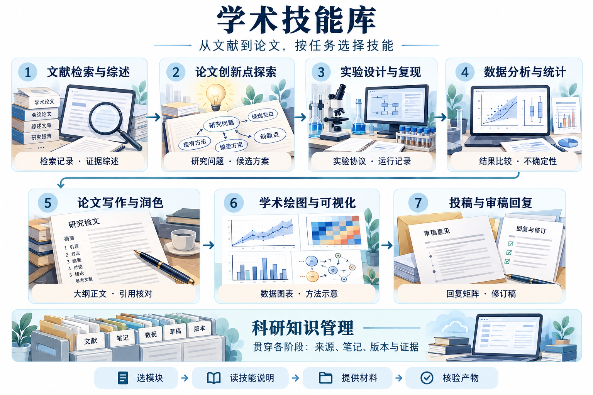

# 学术技能库 · Academic Research Skills

让 AI 帮你读论文、整理研究想法、修改学术文字，也能逐步扩展到实验、分析和投稿。

**第一次来？先完成一个小任务。你不必先认识技能名、来源项目或八个模块。**

[第一次使用指南](docs/GETTING_STARTED.md) · [三张任务卡](prompts/README.md) · [全部技能速查](docs/SKILL_CATALOG.md)

## 先试一次：没有论文也能练

让能读取本地文件的 AI 助手打开本仓库，复制下面这段话。还没准备好工作区？看[下载与打开](docs/GETTING_STARTED.md#prepare)。

```text
我第一次使用这个仓库，请先读 prompts/README.md，
按“读懂论文”路线，用仓库自带的教学稿带我练习。
用中文解释：研究的问题、方法、已有证据、局限，以及 3 个值得追问的问题。
标明这是教学材料和实际阅读范围，先只在对话中回答。
```

你会得到一份简短的材料解读。第一次练习只读现有文字，不需要运行实验或配置知识库。[看看怎样判断完成](docs/GETTING_STARTED.md#done)

## 换成自己的材料：从这三个任务里选一个

| 我现在想做什么 | 需要准备什么 | 直接开始 |
|---|---|---|
| 读懂一篇论文 | 论文文件，或一段摘要/正文 | [复制读论文任务卡](prompts/read-paper.md) |
| 整理一个研究想法 | 一个兴趣、困惑或观察 | [复制想法任务卡](prompts/develop-idea.md) |
| 改好一段学术文字 | 一段中文或英文原稿 | [复制文字任务卡](prompts/polish-text.md) |

每张任务卡都带有可直接复制的练习样例。先在对话中试一次，再把材料换成自己的；助手会选择所需技能，需要保存、联网或运行代码时再补充条件。

## 第一次完成后，再往前走一步

| 已经有了什么 | 下一步可以做什么 |
|---|---|
| 一篇论文的阅读笔记 | [比较更多论文、做专题综述](modules/literature-review/USAGE.md) |
| 一个明确的候选问题 | [设计基线、对照和消融](modules/experiment-design/USAGE.md) |
| 实验结果或预测记录 | [整理结果、分析不确定性](modules/data-analysis/USAGE.md) |
| 有证据的结果和草稿 | [组织全文](modules/paper-writing/USAGE.md) · [制作图表](modules/academic-figures/USAGE.md) |
| 稿件或审稿意见 | [检查稿件、准备逐条回复](modules/submission-rebuttal/USAGE.md) |
| 越来越多的笔记和文件 | [建立项目记录与知识库](modules/research-knowledge/USAGE.md) |

已有自己的研究问题、论文和数据？从[通用新手入口](workflows/automated-research/START_HERE.md)开始：助手自动检查材料与当前所需依赖，生成中文检查页，说明缺口和下一步。暂时缺材料也可以开始，不必填写JSON或先选择技能。[三个可复制示例](workflows/automated-research/EXAMPLES.md)

需要了解完整衔接方式时，再看[自动化科研 pipeline](workflows/automated-research/README.md)与[技能组合说明](workflows/automated-research/COMPOSITION.md)。

想看自己的课题怎样接入？跟做[企鹅体重预测：真实自定义课题](examples/real-penguins/README.md)，查看六步完整记录、代码版本固定、独立复算，以及保留的反向结果。只需 Python 标准库即可复跑这个实例。

想先了解每一步？试试[六步流程](workflows/research-starter/README.md)，或直接跟做[真实论文与公开数据案例：葡萄酒品种分类](examples/real-wine/README.md)。想自己选技能时，再看[完整技能用法速查](docs/SKILL_CATALOG.md)。

<details>
<summary><strong>展开八个模块的全流程地图</strong></summary>



这是一张导航示意图。可以从当前已有材料对应的阶段开始，写作与绘图可以交叉推进。[模块索引](MODULE_INDEX.md) · [配图说明](docs/assets/README.md)

</details>

<details>
<summary><strong>使用范围、来源与维护信息</strong></summary>

本库保存固定版本技能和中文指南，助手需能读取所选文件；没有自动注册统一的斜杠命令。只有普通聊天界面时，也可复制任务卡并粘贴材料做基础练习，见[常见问题](docs/GETTING_STARTED.md#faq)。

文献模块有部分实测，实验模块本轮验证仍在进行；完整上游工作流尚未全部验证。按[运行状态](docs/RUNTIME_STATUS.md)查看具体范围。

[来源与许可](THIRD_PARTY_NOTICES.md) · [研究交接](docs/RESEARCH_WORKFLOW.md) · [证据检查](docs/EVIDENCE_CHECKS.md) · [收录规范](CONTRIBUTING.md) · [更新记录](CHANGELOG.md) · [任务卡实测](docs/onboarding-tests/2026-10-22/README.md) · [发布说明](docs/PUBLISH.md)

维护者可运行 `python3 scripts/verify_bundle.py`（Windows：`py -3.12 scripts/verify_bundle.py`）核对发布清单、摘要及来源。上游快照保持原目录和原文件；最近维护日期为 2026-10-23。

</details>
