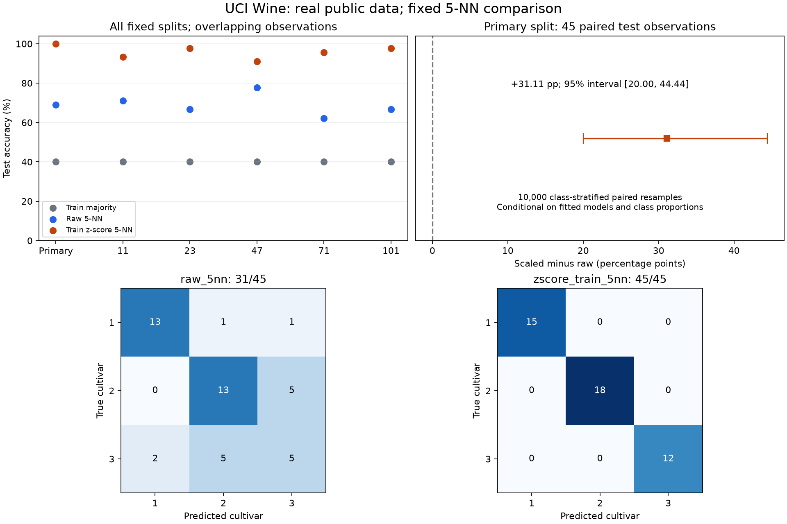

# 真实课题：标准化会改善葡萄酒品种分类吗？

[六步流程](../../workflows/research-starter/README.md) · [每步输入、输出与问题](WALKTHROUGH.md) · [实际研究报告](REPORT.md) · [验证记录](VALIDATION.md)

用 **UCI Wine 的真实化学分析数据**，比较同一批测试样本上的原始尺度 5-NN 和训练集标准化 5-NN。数据只有 178 行、13 个指标、三个品种类别，普通电脑即可完成。核心程序只需要 Python 标准库，数据已经按许可附在本目录，可以离线复跑。

**先读结果：**主测试集原始模型正确 31/45，标准化模型正确 45/45，差 31.11 个百分点；其余五个预先固定划分的标准化准确率为 91.11%–97.78%。这是一项真实数据上的学习性比较；不能由一次 100% 推出模型永远正确。

## 直接让助手带你走

在仓库工作区复制：

```text
请读取 examples/real-wine/README.md，带我用这个真实课题走完六步流程。
先解释要比较的问题，核对 sources.json 的两篇论文及实际阅读范围，
再检查 UCI Wine 的数据身份、许可和 protocol.json。
使用本例固定参数、公开数据和普通 CPU，运行前检查 Python。
运行产物放在仓库外一个全新目录，保留所有条件，不覆盖旧结果。
逐步记录输入、实际操作、输出和遇到的问题，再核对预测与数据泄漏，
最后用中文交付一页有证据和限制的小报告。
核心程序无需额外包；若当前不能联网或绘图，明确标出未完成的步骤，
不要把历史阅读记录当作本次新阅读，也不要把已有成绩当作本次运行。
```

## 自己运行：两条核心命令

本轮实测 Windows / CPython 3.12.10。先确认 `py -3.12 --version` 可用；已有 `python` 命令时，也可统一使用对应的解释器。下面在**仓库根目录的 PowerShell**中执行：

```powershell
$runDir = Join-Path $env:TEMP ('ars-wine-' + [guid]::NewGuid().ToString('N'))
Write-Output "本次输出位置：$runDir"
py -3.12 -B examples/real-wine/run_case.py --output "$runDir"
if ($LASTEXITCODE -ne 0) { throw '先处理上方错误，当前结果还不能进入结论。' }
py -3.12 -B examples/real-wine/verify_case.py --input "$runDir"
if ($LASTEXITCODE -ne 0) { throw '结果未通过核对，请保留产物并检查错误。' }
Write-Output "完成后请打开：$runDir/results.md"
```

也可以先核验仓库保存的这次真实产物，无需重新计算：

```powershell
py -3.12 -B examples/real-wine/verify_case.py --input examples/real-wine/recorded
```

程序不会联网或安装包。它读取固定数据和协议，生成全部预测、划分、标准化参数、统计结果和简短数值报告。人工可读的来源解释与中文研究小结另见 [REPORT.md](REPORT.md)，没有通过外部模型自动生成论文。

## 图表与完整输出



图由本次实际结果生成。[可编辑 SVG](gallery/comparison.svg) · [PDF](gallery/comparison.pdf) · [图中数据](gallery/plotted-data.json)

已有 Matplotlib 环境时，可为自己的新运行生成图；安装方式与已测版本见[绘图环境说明](../../modules/academic-figures/examples/README.md)。核心实验和核验不受绘图库是否可用影响。

```powershell
# python 应指向已具备 Matplotlib 的环境，runDir 为上面成功运行的目录
python -B examples/real-wine/plot_case.py --input "$runDir"
```

| 想核对什么 | 本轮保存的位置 |
|---|---|
| 原始数据、署名与许可 | [data/README.md](data/README.md) · [DATA_SOURCE.json](DATA_SOURCE.json) |
| 真实论文、版本与未读范围 | [sources.json](sources.json) |
| 第一次评价前固定的方案 | [protocol.json](protocol.json) |
| 每条测试预测及五个近邻 ID | [recorded/predictions.csv](recorded/predictions.csv) |
| 每个划分及训练集拟合参数 | [splits](recorded/splits.json) · [scalers](recorded/scalers.json) |
| 全部准确率、平衡准确率、混淆矩阵 | [metrics.json](recorded/metrics.json) |
| 配对变化、重采样分布与区间 | [paired-analysis.json](recorded/paired-analysis.json) |
| 命令和故障用例 | [runtime.json](validation/runtime.json) · [checks.json](validation/checks.json) |

本例目前只支持这份已固定的 UCI Wine 数据。替换自己的 CSV 需要重新确认标签、特征、抽样与协议；不能只换文件名。尚未有葡萄园、年份或批次标识，也没有验证新地区酒样、其他分类器或完整上游技能流程。
