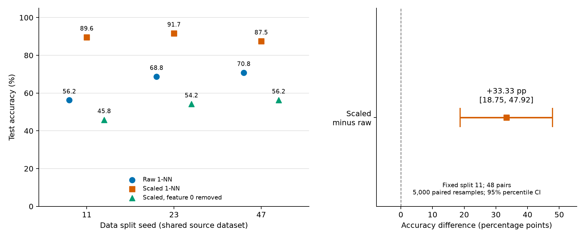

# 从同一分析产物到图表

[模块首页](../README.md) · [验证记录](VALIDATION.md) · [连续案例](../../../examples/research-workflow/README.md)

本例沿用合成 1-NN 实验与配对分析。左图显示全部三个 seed、三个条件的测试准确率；右图显示固定 split 11 的配对差及受条件限制的区间。另提供结构说明 JSON，由既有 ARIS 单文件渲染器生成流程 SVG。图中文字用英文以减少环境字体差异，中文解释在下方。



左侧每种条件、每个划分均为 48 个测试样本；各划分共享同一数据集，点不连成趋势线，也不汇总为独立重复。右侧为 scaled 减 raw，点估计 +33.3333 个百分点，95% percentile 配对 bootstrap 区间 [18.7500, 47.9167]，5,000 次重采样、seed 20261022。区间条件于固定划分与拟合模型，并假设 IID 测试观察；不覆盖训练、选模、跨划分不确定性。这里是事后合成教学，不作确认性显著结论。

[可编辑结果 SVG](gallery/comparison.svg) · [结构 SVG](gallery/pipeline.svg) · [结构源 JSON](pipeline-spec.json)

## 环境与运行

本轮实测 CPython 3.12.10 / Windows，Matplotlib 3.11.2。依赖在临时隔离目录安装，未修改全局环境。复跑时可在自己的项目目录建立虚拟环境，再按 [requirements.txt](requirements.txt) 安装已记录版本；安装需要包源访问。不能把仅有 Python 标准库等同于绘图库已就绪。

```powershell
# 在自己的项目目录执行；将下方路径替换为本仓库实际位置
py -3.12 -m venv .venv
.\.venv\Scripts\python.exe -m pip install -r "仓库位置/modules/academic-figures/examples/requirements.txt"
```

下面在仓库根目录运行，python 应指向上述已有绘图库的环境，所有输出目录必须尚不存在：

```powershell
python -B modules/experiment-design/examples/toy-reproducibility/run_demo.py --output "$env:TEMP/ars-plot-input"
python -B modules/data-analysis/examples/paired-analysis/analyze_demo.py --input "$env:TEMP/ars-plot-input" --output "$env:TEMP/ars-plot-analysis"
python -B modules/academic-figures/examples/plot_results.py --experiment "$env:TEMP/ars-plot-input" --analysis "$env:TEMP/ars-plot-analysis" --output "$env:TEMP/ars-plot-a"
python -B modules/academic-figures/examples/verify_figures.py --experiment "$env:TEMP/ars-plot-input" --analysis "$env:TEMP/ars-plot-analysis" --output "$env:TEMP/ars-plot-a"
```

程序先调用前序原创验证器，核对输入与分析，再读取实际数据绘图，不把示例分数硬编码为图点。输出 comparison.svg/pdf/png、plotted-data.json、caption.md 和 manifest.json。后者保留产物、输入 manifest、代码摘要和库版本。可再生成新目录，并给验证器增加 `--compare 第二目录` 检查五个产物的字节一致性；相同环境内通过不证明跨平台相同。

## 可选：运行既有结构图组件

在仓库根目录、确认输出文件尚不存在时运行：

```powershell
python -B -X utf8 modules/idea-discovery/01_ARIS/upstream/skills/figure-spec/scripts/figure_renderer.py validate modules/academic-figures/examples/pipeline-spec.json
python -B -X utf8 modules/idea-discovery/01_ARIS/upstream/skills/figure-spec/scripts/figure_renderer.py render modules/academic-figures/examples/pipeline-spec.json --output "$env:TEMP/ars-pipeline-new.svg"
```

此命令实际执行固定上游单文件；原组件可覆盖同名文件，所以需使用新位置。只覆盖 SVG 校验与渲染，没有执行完整技能审阅、可选 preview 转换、Mermaid CLI 或 AI 插图。图库流程图由此生成并人工查看预览，PNG 预览转换使用已有 sharp 工具且不属于 ARIS 组件测试。

验证器核对输入、摘要、绘图数据与文件格式标识，不独立证明图面映射、所有渲染兼容性或科学结论。代码审阅、数值复算和实际图像检查分别列于验证记录。
