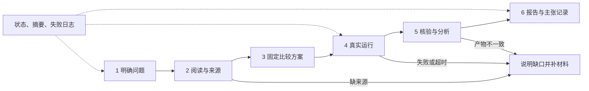

# 一次启动，按证据推进的科研 pipeline

[返回首页](../../README.md) · [热门仓库比较](../../docs/discovery/2026-10-23/README.md) · [实际验证](VALIDATION.md)

把现有六步流程变成可记录、可恢复的执行过程。你只说研究问题，助手选择当前所需技能；每一步都有输入、交付物和继续条件。

**默认组合：K-Dense 问题界定 → ARIS 检索与实验规划 → ClaudeScholar 引用和统计约束 → 本库运行/核验器 → ARIS 写作组织。** 借鉴热门自动化项目的固定评价、有限预算和阶段恢复，把它们落实为本库原创编排代码。完整来源、版本和取舍见[选型说明](COMPOSITION.md)。

## 先直接试一次

在能读取本仓库、执行 Python 的助手中复制：

```text
请读取 workflows/automated-research/SKILL.md，先检查环境，
用默认 Wine 案例运行自动化 pipeline，产物放在仓库外的新目录。
读取本次报告，告诉我实际结果、哪些资料沿用旧记录、还有什么没验证。
```

默认案例只需要 **Python 3.10+ 标准库**，实测版本见验证记录。它复用已核对的真实论文阅读记录和公开 Wine 数据，再实际运行实验、重算结果并生成中文报告。无需密钥或 GPU；程序不联网、不安装包、不调用写作模型。

想自己操作，在仓库根目录的 PowerShell 中执行：

```powershell
py -3.12 -B scripts/research_pipeline.py doctor
if ($LASTEXITCODE -ne 0) { throw '先解决环境检查给出的问题。' }
$runDir = Join-Path $env:TEMP ('ars-pipeline-' + [guid]::NewGuid().ToString('N'))
py -3.12 -B scripts/research_pipeline.py demo --output "$runDir"
if ($LASTEXITCODE -ne 0) { throw '查看本次目录中的 NEXT.md 和事件记录。' }
py -3.12 -B scripts/research_pipeline.py verify --run "$runDir"
if ($LASTEXITCODE -ne 0) { throw '核验未通过，不能沿用报告结论。' }
Write-Output "本次报告：$runDir/REPORT.md"
```

macOS/Linux 将 `py -3.12` 换成环境中的 `python3`，用一个仓库外的新目录作为 `--output`。此轮 Windows 实测不等于所有系统均已验证。不要使用 `-O`；它会关闭现有数值核验器使用的断言，编排器会拒绝该模式。

## 换成自己的课题

复制下面的任务，替换题目和材料描述即可，助手负责文件接口：

```text
请用 workflows/automated-research/SKILL.md 推进我的课题：
【写一个想研究的问题】。已有材料：【论文、公开数据或本地文件位置】。
先读取现有材料再确定最小比较，使用当前环境和已授权资源。
为项目创建独立运行目录，按 NEXT.md 一步步补齐并检查交付物。
能继续就继续；缺少决定性材料时告诉我具体缺哪一项。
不得把旧来源记为新检索、把待运行内容写成实验结果。
```

助手先用 `init --topic "题目" --output "新目录"` 创建记录；题目以外的未知内容保留空白。之后按 `NEXT.md` 完成当前阶段，再用 `advance --run "目录"` 接着走。它不会从一句话自行完成任意领域研究：联网阅读、实验实现和科学判断由当前助手利用实际可用工具完成，编排器负责顺序、材料核对和状态。

初始化因信息待补返回 `2` 是预期行为，运行目录已经创建。默认首轮最多登记四次检索、八条来源；需要更大范围时，在初始化中用 `--max-searches` 和 `--max-sources` 指定正整数上限。不要事后修改状态来突破原定范围。

普通用户无需填写 JSON；需要接入自己程序的维护者读 [CONTRACTS.md](CONTRACTS.md)。自定义 `command` 只是运行记录，不会被执行器当成系统命令运行。

## 六步如何衔接



| 阶段 | 默认案例自动完成什么 | 自定义课题由助手完成什么 |
|---|---|---|
| 问题 | 导入已有 Wine 问题和范围，标记复用 | 从材料确定一个比较和停止条件 |
| 证据 | 导入历史阅读范围和失败条目，保留原日期 | 实际检索/阅读，核对身份、版本及支持位置 |
| 协议 | 使用原固定协议，不改数据或参数 | 明确数据、基线、独立单位、划分和评价 |
| 实验 | 实际运行六个划分、三个条件 | 准备并运行适合课题的程序，登记真实产物 |
| 分析 | 另一个程序重算预测、训练参数与区间 | 完成适用分析、数值验证、全部条件和限制 |
| 报告 | 用本次结果生成中文模板报告和主张映射 | 根据证据写报告，逐项核对强度和未决项 |

## 中断后怎么继续

运行 `status --run "目录"` 查看状态，读取 `NEXT.md`，补齐当前阶段后运行 `advance --run "目录"`。已完成且未变化的阶段直接复用。程序检查输入、代码和已接受产物摘要；如果这些发生变化，需要新运行目录，不能继承旧结论。

- 返回 `0`：该命令成功；仍需看 `validation_scope` 确认核验范围。
- 返回 `2`：缺少材料，停在当前阶段。补齐后可继续。
- 返回 `1`：发生错误或校验不通过；查看状态和日志，失败不会被标成通过。

看报告用 `REPORT.md`；看下一步用 `NEXT.md`；查过程用 `state.json` 与 `events.jsonl`。运行不会覆盖已有目录；失败尝试有独立记录。

`status` 返回 `0` 只表示查询成功，项目本身仍可能是 `blocked`；以显示的阶段状态为准。助手应将 `NEXT.md` 中的字段解释成当前缺少的材料，而不是要求新手自己编辑结构文件。

每次内置计算/核验最多运行 120 秒；实验、分析阶段各最多三次尝试，由你或助手明确续跑，不自动反复尝试。达到上限后保留日志，修复原因并另开运行。`verify` 是用户主动要求的复核，不受这三次尝试限制。

## 哪些已自动化，哪些仍需要判断

已实现的是阶段编排、按需技能路由、依赖检查、Wine 实跑及数值复核、记录归档、断点恢复和模板报告。自定义流程自动检查文件结构、摘要、来源/主张引用关系；这些检查不能证明一句话的科学含义正确。

当前没有新装整套热门项目，没有付费检索、无限自改实验循环、自动投稿或后台定时运行。需要更多数据库、专门统计或外部审阅时，按[组合选型](COMPOSITION.md)接入相应能力，并单独记录验证结果。所有上游完整工作流的状态继续保持原有范围。
