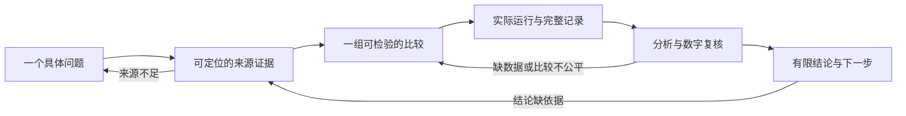

# 从一个问题到一份有证据的小报告

[返回首页](../../README.md) · [新技能检索与实测](../../docs/discovery/2026-10-22/README.md) · [已完成案例](../../docs/discovery/2026-10-22/pipeline-walkthrough.md)

适合已经试过三张任务卡、想把阅读和一个小实验连起来的新手。第一次只完成一个问题、一组比较和一页结论；助手根据当前阶段读取必要技能。

**想直接用真实论文与公开数据？**跟做 [UCI Wine品种分类](../../examples/real-wine/README.md)：核心程序只用Python标准库，附原始公开数据、逐步记录和已测结果。下方保留合成数据练习，方便先理解基本过程。

## 想让流程自动衔接

使用[自动化入口](../automated-research/README.md)，即可检查依赖、实跑默认 Wine 案例、保存每步状态并在中断后继续。自己的课题由助手按同一套交付接口推进。这里继续保留六步原理和早期教学路径，方便理解每一步为什么需要证据。

## 直接开始

在能读取本仓库的助手里复制下面整段。示例已经填好，之后可把最后一段换成自己的问题。

```text
请按 workflows/research-starter/README.md 带我完成一次小研究练习。
先用中文说清问题、已有材料和能做的比较，再逐步完成来源记录、
实验计划、实际运行、结果核对和一页小报告。复用仓库已有技能。
每步告诉我拿到了什么、还有什么不知道；有足够材料时继续，
缺少决定性材料时只问最必要的一项，不替我编数据或实验结果。
请先采用下面的教学题目：不同特征尺度怎样影响 1-NN 分类？
使用仓库现有合成数据案例，普通 CPU，不购买服务、不接私人知识库。
允许检索公开资料并执行本库原创教学程序；先检查 Python 和绘图依赖。
运行产物放到仓库外一个新目录，最后告诉我实际位置。
这次是教学复跑，不把既有结果包装成预注册研究或新发现。
```

**你应拿到：**一页问题与计划、可点开的来源与证据表、一份实际运行记录、一张结果图和一页有适用范围的报告。完整交付样子见[本轮案例](../../docs/discovery/2026-10-22/pipeline-walkthrough.md)。

只有普通聊天界面时，先粘贴自己的材料完成问题和证据整理；不能访问文件、检索或运行程序的步骤标为“待完成”，不要把演示数字当作本次结果。

## 用真实数据时先核对这五项

2026-10-23 的[真实案例走查](../../examples/real-wine/WALKTHROUGH.md)发现，资料能打开还不足以建立可比较的实验。进入第3步前，由助手填写下面五项，新手不必自己挑选技能：

| 项目 | 需要核对什么 | 本轮实际遇到的例子 |
|---|---|---|
| 数据身份 | 来源/版本、标签意义、特征、行数、许可、文件摘要 | Wine品种类别与Wine Quality质量分数不同；不能混作一个任务 |
| 阅读范围 | 论文版本、已读章节、可定位证据；获取失败单独写明 | 出版方403时只保留真实可读版本，不补写全文结果 |
| 评价可比性 | 样本、训练测试划分、模型、指标、分母、调参规则 | 历史1-NN留一法成绩与本例5-NN留出集不能直接排名 |
| 参数与抽样 | 预处理只拟合训练数据；保留可重建的划分和独立单位 | 真实数据按类排序，采用固定分层划分；数值重算发现全数据拟合反例 |
| 结果状态 | 实测/待执行/模拟分开；保存全部预定条件与有限结论 | 主划分45/45仍须展示其他划分的错误；810条记录不是810个独立样本 |

先固定本次要比较的条件，再读取指标；若方案此前已知或已有旧结果，记录这一事实，不改称预注册。没有调参不必强加验证集；需要选参数时，在训练数据内另设验证。缺绘图库时先完成数值链，图表单独标为待做。

## 六步怎么走



| 步骤 | 助手需要做什么 | 交付与继续条件 |
|---|---|---|
| 1. 定一个小问题 | 根据兴趣和资源写一个能比较的问题；兴趣太泛时先问一个实际困难 | 写明问题、可用材料、资源和反证条件；未知条件不代填 |
| 2. 找证据 | 先做小批量公开检索，记录检索词、筛选理由、真实阅读范围和来源定位 | 区分论文、官方文档和自己的推断；来源存在与支持句子分别核对；找不到就保留缺口 |
| 3. 定比较 | 写明基线、改变什么、保持什么、如何划分数据、指标与失败解释 | 计划中不出现未运行的成绩；既有协议注明是复跑；结果不支持时也要保留 |
| 4. 真运行 | 在已明确的环境执行必要程序，保存配置、日志、预测和失败尝试 | 实际产物可读取且完整；模拟、失败、缺依赖分别记录，不能只看退出码 |
| 5. 分析 | 列出全部条件、分母和配对关系；核对数字及图中每个点 | 不只选最好的一次；共享数据的划分不当作独立研究；区间说明条件与未覆盖的不确定性 |
| 6. 写小结 | 用证据写“观察—解释—限制—下一步”，再检查每个结论 | 来源、数字、语义三项分别过检查；缺证据的结论收窄或暂不写 |

“反证条件”就是：看到什么结果时，不能再支持原先想法。整个流程可以停在其中一步；报告明确完成到哪里，不把材料齐全当作科学结论正确。

## 助手按需复用的技能

这是本库原创的轻量组合流程，不注册新的斜杠命令，也不要求安装所有候选项目。先读相关模块索引，再读一个必要入口；下表列出可复用组件，不表示完整执行了每个上游流程。

| 环节 | 已有入口 | 本流程提取的部分 |
|---|---|---|
| 问题 | [想法任务卡](../../prompts/develop-idea.md) / [idea 索引](../../modules/idea-discovery/SKILL_INDEX.md) | 明确一个小问题与可用资源 |
| 检索 | [文献索引](../../modules/literature-review/SKILL_INDEX.md) → [ARIS research-lit](../../modules/idea-discovery/01_ARIS/upstream/skills/skills-codex/research-lit/SKILL.md) | 真实检索、来源表、阅读边界与待补证据 |
| 引用 | [ClaudeScholar citation-verification](../../modules/idea-discovery/05_ClaudeScholar/upstream_codex/skills/citation-verification/SKILL.md) | 核对身份、版本及支持位置；失败保留未知 |
| 设计 | [实验索引](../../modules/experiment-design/SKILL_INDEX.md) → [ARIS experiment-plan](../../modules/idea-discovery/01_ARIS/upstream/skills/skills-codex/experiment-plan/SKILL.md) | 主张、证据需求、最小比较和运行顺序 |
| 分析 | [分析索引](../../modules/data-analysis/SKILL_INDEX.md) → [ARIS analyze-results](../../modules/idea-discovery/01_ARIS/upstream/skills/skills-codex/analyze-results/SKILL.md) | 完整结果表与观察；比例、百分点和相对提升分开 |
| 严格分析或审计 | 按需要读取 [ClaudeScholar results-analysis](../../modules/idea-discovery/05_ClaudeScholar/upstream_codex/skills/results-analysis/SKILL.md) | 比较单位、配对、允许/禁止措辞；缺材料时停在审计，不补造统计 |
| 短报告 | [文字任务卡](../../prompts/polish-text.md) + [公共证据检查](../../docs/EVIDENCE_CHECKS.md) | 只润色有依据的内容，必要纠错说明依据 |

新增候选的取舍见[检索比较](../../docs/discovery/2026-10-22/candidate-search.md)：借鉴小批量检索、按需路由、来源—主张定位、产物交接及结构审计。外部仓库的服务接入、自动部署、人工签署与完整审阅流程没有因此启用。采用的是中文原创交接约定，没有覆盖已有固定快照。

## 每步只保留一份能核对的记录

助手可先将以下内容放在一个 `research-note.md` 中，不要求新手维护许多表格。运行程序自带的原始产物仍保留在输出目录。

```text
问题：想比较什么？当前材料与资源是什么？
来源：S1 / 标题与网址 / 阅读范围 / 原文定位 / 能支持什么 / 不支持什么
设计：基线 / 改变项 / 样本与划分 / 指标 / 失败条件 / 协议版本
运行：实际命令 / 环境 / 成功、失败或模拟 / 输出位置 / 输入与代码摘要
结果：R1 / 原始产物位置 / 分子、分母、单位 / 配对依据 / 限制
结论：C1 / 确切句子 / S或R编号 / 支持位置 / 允许措辞 / 仍缺什么
下一步：一个最有价值的补充检查
```

网络超时或限流写为“获取失败”，不写“论文不存在”。自动脚本标为通过时，仍须核对正文数字与实际产物，并检查没有数字的结论句。本轮外部审计组件恰好漏检了这两类问题，见[五个用例](../../docs/discovery/2026-10-22/component-probe.md)。

## 教学题目的实际运行方法

实验与分析仅需 Python 标准库；完整图表链需要 Matplotlib，准备方式见[绘图环境](../../modules/academic-figures/examples/README.md)。已有环境可直接使用；没准备依赖时先完成来源和设计，不悄悄安装整套技能或代填成功。

下面在仓库根目录的 **PowerShell** 中执行，`python` 应指向已具备绘图依赖的环境。使用随机目录名避免覆盖旧结果：

```powershell
$runDir = Join-Path $env:TEMP ('ars-starter-' + [guid]::NewGuid().ToString('N'))
Write-Output "本次计划输出位置：$runDir"
python -B examples/research-workflow/run_workflow.py --output "$runDir"
if ($LASTEXITCODE -ne 0) { throw '运行未完成，先看上方错误；若已生成输出目录，再查看其中的 run-log.json。' }
python -B examples/research-workflow/verify_workflow.py --input "$runDir"
if ($LASTEXITCODE -ne 0) { throw '产物未通过核对，先修复问题再写结论。' }
Write-Output $runDir
```

该运行器只执行原创实验、分析与绘图，并登记以前编写的教学文档版本；**本次来源整理、解释和新短报告由宿主根据实际产物完成**。它不自动联网搜文献或调用写作模型。看到最后一行路径后，读取 `analysis/analysis.json`、`figures/comparison.png`、`run-log.json` 与 `handoff.json`，按六步表完成小结。

换成自己的研究时，通用六步仍适用，但现有教学脚本只支持固定合成案例，不能直接导入任意 CSV。助手应先查看数据与设计，准备对应分析；涉及访谈、受试者或专门实验时，另补该研究所需的方案与条件。

## 本轮验证到了哪里

2026-10-22 实际完成同题公开资料检索、限定技能宿主整理、原创合成实验/分析/图表复跑、独立计数及反例检查，见[原始记录](../../docs/discovery/2026-10-22/README.md)。2026-10-23 又完成[真实论文与UCI Wine数据案例](../../examples/real-wine/VALIDATION.md)，保存六步实际输入/输出、真实结果和九项检查。两项是各自限定案例的证据；完整上游工作流、真人新手可用性及跨领域研究效果仍未验证。
